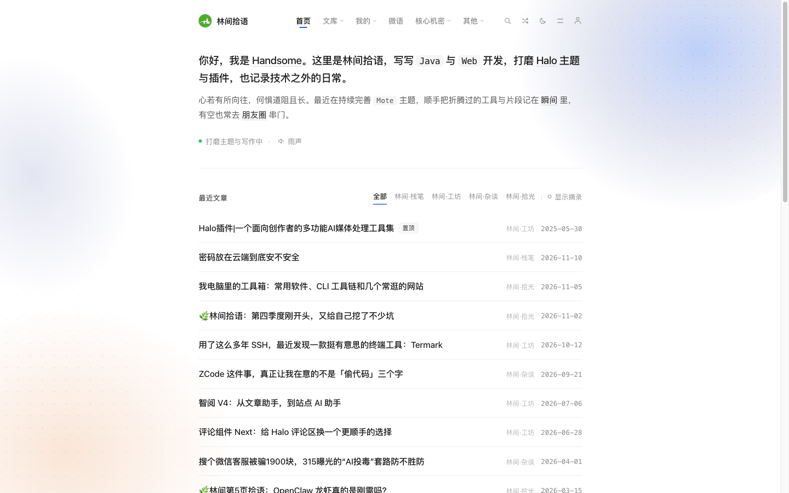
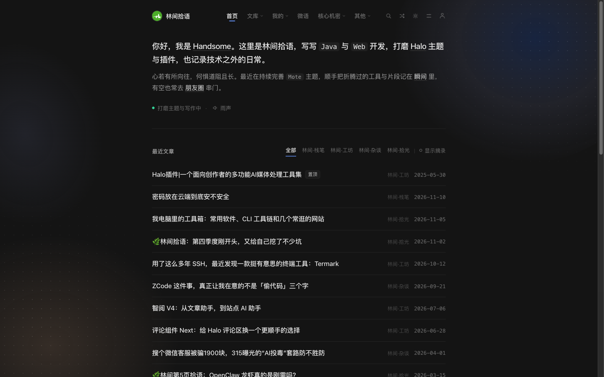
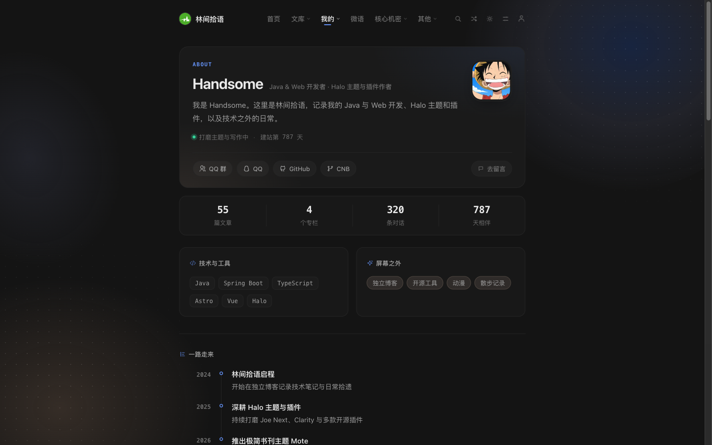
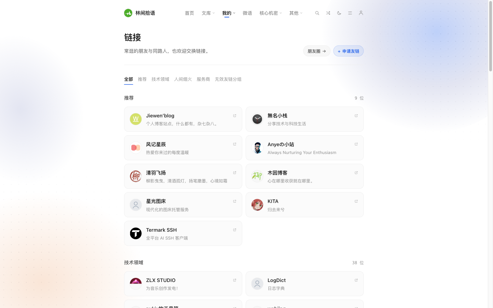
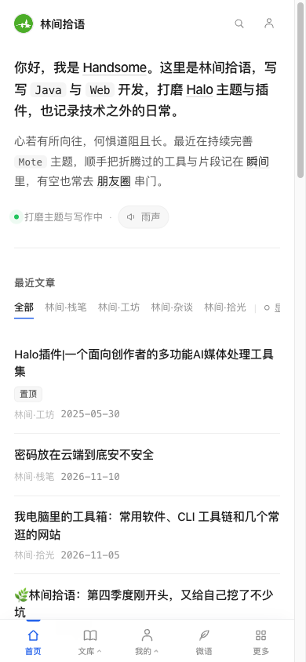

<p align="center">
  
</p>

<h1 align="center">Mote</h1>

<p align="center">
  一款极简耐看的 Halo 单栏个人博客主题，专注中文阅读体验，融合封面取色、平滑切页、移动端底部 TabBar 与独立站生活记录。
</p>

<p align="center">
  <a href="https://www.xhhao.com" target="_blank">在线预览（林间拾语）</a> ·
  <a href="https://github.com/acanyo/theme-mote/releases" target="_blank">版本下载</a> ·
  <a href="https://github.com/acanyo/theme-mote/issues" target="_blank">问题反馈</a> ·
  <a href="https://qm.qq.com/q/a57GByg0IU" target="_blank">QQ 交流群</a>
</p>

---

## 主题预览

### 首页 · 纯净亮色 / 柔和暗色

| 纯净亮色（默认） | 柔和暗色 |
| :---: | :---: |
|  |  |

### 文章阅读（随封面自动取色） & 关于我独立页

| 文章页 · 随封面图自动取色与氛围光带 | 关于我 · 个人名片 / 站点脉搏 / 时间线 |
| :---: | :---: |
|  |  |

### 友情链接 & 移动端原生底部 TabControl

<table>
  <tr>
    <td align="center" width="72%">
      
      <br /><sub>友情链接 · 分组筛选、朋友圈直达与自助申请</sub>
    </td>
    <td align="center" width="28%">
      
      <br /><sub>移动端 · 贴边底部 TabControl 与极简顶栏</sub>
    </td>
  </tr>
</table>

---

## 核心特性

- **极简刊物排版**：700px 单栏中文长文阅读韵律，支持正文字号（紧凑 / 标准 / 舒适）与无衬线 / 书刊衬线体实时切换，附带右侧伴读目录（TOC）与 `@media print` 刊物级打印样式。
- **随封面图自动取色**：文章页、独立页与项目详情页自动提取封面主副色调（WCAG AA 亮暗对比度自动校正、持久化 LRU 缓存，可选云端图床 `?imageAve` 主色接口），联动页面强调色、顶部渐隐氛围光带、浏览器 `theme-color` 状态栏以及搜索/评论组件。
- **无刷新平滑切页与意图预加载**：内置 Swup 无刷新切页，切页期间细雨白噪音不断流；采用「柔暗留驻 + 120ms 延迟双微尘呼吸胶囊 + 顶部进度丝线」消除白屏闪烁，结合按下抢跑与可中断串行意图预热提升切页响应速度；内置 View Transitions API 圆形扩散明暗切换与桌面端零抖动悬浮封面预览。
- **移动端原生导航体验**：手机端（`≤720px`）默认提供贴边底部 TabControl 导航栏（自动适配一级菜单与上拉浮层子菜单 / 更多抽屉）与精简顶栏，文章页自动收起为轻量伴读浮标，亦可一键切回传统汉堡菜单。
- **登录入口与本地访客足迹**：顶栏右上角自适应展示登录入口 / 已登录用户菜单，未登录访客在站内评论后亦自动识别访客身份，支持随时查看本地阅读、点赞与评论足迹。
- **细节与视觉质感**：提供 6 套图片悬停看图光标（取景框 / 放大镜 / 展开圆标 / 毛玻璃 / 光圈环 / 查看胶囊）、自定义图片加载中与失败占位图（支持点击重试）、极简双层刊物尾注页脚与书信收尾卡。
- **单篇元数据精细控制**：内置 `annotation-setting.yaml`，可在单篇文章或独立页中按需开关封面、目录、作者卡、时效提醒、自定义提示、版权/参考来源、GEO 核心要点摘要与专属强调色。
- **SEO & GEO 结构化增强**：支持自定义首页副标题拼接与全站标题分隔符（`-` / `|`），自动输出 Schema.org `@graph` JSON-LD（`WebSite`、`Person`、`BlogPosting` + `Speakable`、`ProfilePage`、`BreadcrumbList`）、Open Graph / Twitter Card、RSS 及可选 `LLMs.txt` 发现声明（可独立关闭 Meta 以兼容第三方 SEO 插件）。
- **独立站互动与分享**：原生点赞、文章极简满版「书签图」海报生成（浅纸 / 夜墨双风格 + 二维码）与可选微信/支付宝赞赏弹窗。

## 自定义页面模板

在 Halo 后台「页面」新建或编辑独立页时，可在右侧「页面设置 → 自定义模板」中选择：

| 模板名称 | 模板文件 | 说明 |
| :--- | :--- | :--- |
| **关于我（个人名片与自述页）** | `page_about.html` | 整合刊首名片、站点脉搏数据条、技术与兴趣标签、个人历程时间线、书信正文与版权声明，配合后台「关于页面」分组零配置即可使用 |
| **朋友圈（友链订阅动态）** | `page_friends.html` | 展示友链站点的最新 RSS 订阅动态（需开启 `PluginLinks` 2.5+ 订阅功能），并在主题设置「友链信息」中填写对应路径（如 `/friends`） |
| **留言板（极简书信页）** | `page_guestbook.html` | 极简书信风格留言页，支持随封面图取色并直接衔接评论区 |

## 插件适配

所有插件均为**可选适配**，未安装时自动隐藏对应入口与区块：

| 插件 | 路由 / 能力 | 适配亮点 |
| :--- | :--- | :--- |
| **评论组件**（`PluginCommentWidget` / `comment-next`） | 文章、单页、瞬间、留言板、关于 | 深度对接亮暗双色、封面强调色与纯净输入框质感 |
| **搜索组件**（`PluginSearchWidget`） | 顶栏搜索与快捷键 | 全局配色与暗色模式同步 |
| **瞬间**（`PluginMoments`） | `/moments`、`/moments/{name}`、首页 | 去框化微日记流、紧凑拼图画廊、列表原位点赞与按需展开评论（评论数实时同步） |
| **图库**（`PluginPhotos`） | `/photos`、首页光影条 | 分组切换、专属看图光标与全屏灯箱 |
| **友链管理**（`PluginLinks` 2.5+） | `/links`、首页、自定义朋友圈页 | 分组展示、自助申请弹窗，支持 `page_friends.html` 朋友圈 RSS 动态 |
| **项目集**（`portfolio`） | `/portfolio`、`/portfolio/{slug}`、首页 | 替换首页「在做的小东西」，含筛选搜索、技术栈标签与封面取色详情页 |
| **装备管理**（`equipment`） | `/equipments` | 分组切换与极简横向器物展台清单 |
| **豆瓣**（`plugin-douban`） | `/douban` | 电影 / 图书 / 音乐 / 游戏切换、状态与题材筛选、评分与短评展架 |
| **文章组件 / 弹幕互动**（`content-widgets` / `comment-interact`） | 文章与单页 | Swup 切页自动重挂文章组件，离开含弹幕页面自动停止并清理残留弹幕 |
| **RSS / Sitemap**（`PluginFeed` / `PluginSitemap`） | `/feed.xml`、`/sitemap.xml` | 页脚直达入口与 `<link rel="alternate">` 订阅发现 |

## 安装与上手

1. **安装主题**：
   - 在 Halo 后台「应用市场」搜索 **Mote** 一键安装，或前往 [Releases](https://github.com/acanyo/theme-mote/releases) 下载 `theme-mote-<version>.zip` 后在「外观 → 主题 → 安装」上传启用。
2. **推荐基础配置**（外观 → 主题设置）：
   - **基本与外观**：按需设置主副配色、桌面窗光背景、看图光标与移动端底部 TabControl。
   - **首页与首屏**：填写自我介绍、近况与此刻状态（支持内联 HTML 与 `<code>`）。
   - **关于页面**：在后台新建或编辑 `/about` 单页并选用「关于我」模板，按需补充头衔、技术栈与时间线。
   - **页脚与社交**：填写建站日期（`YYYY-MM-DD`）与 Iconify 社交图标链接。
   - **阅读与 SEO / GEO**：如已安装第三方 SEO 插件，可在此关闭 Mote 的 Meta 输出以避免重复标签。

## 快捷键

- `Shift + A`：打开阅读偏好（明暗、主题配色、字体字号、雨声、减少动画）
- `Shift + ?`：查看快捷键帮助

## 开发与打包

需要 Node.js >= 22.12 与 pnpm（Halo 版本要求 `>= 2.27.0`）：

```sh
pnpm install
pnpm run check   # TypeScript & Astro 类型检查
pnpm run build   # 构建 templates/ Thymeleaf 模板
pnpm run dev     # 监听改动自动重新构建
pnpm run pack    # 构建并打包可直接上传 Halo 后台的 theme-mote-<version>.zip
```

## 交流与反馈

- **QQ 交流群（Halo 插件主题交流群）**：[点击链接加入群聊](https://qm.qq.com/q/a57GByg0IU)
- **问题与建议**：欢迎提交 [GitHub Issues](https://github.com/acanyo/theme-mote/issues)

## 许可协议

[GPL-3.0](https://www.gnu.org/licenses/gpl-3.0.en.html)
